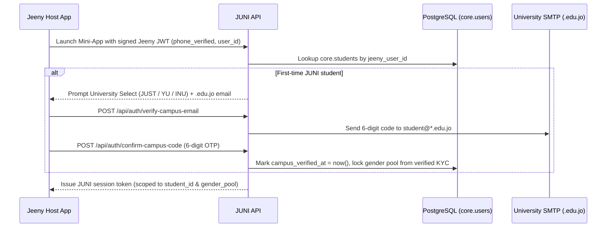

# JUNI Authentication & Rehearsal Access Specification

This document reconciles authentication across **Hackathon/Judge Rehearsal Mode** and **Pilot/Production Onboarding**, resolving audit flaws **F07** (dead-end registration screen) and **F16** (unprotected `/api/demo/claim` endpoint).

---

## 1. Two Modes, Strictly Separated

JUNI never mixes demo persona switching with production authentication, and never shows a broken `"Create account"` form that dead-ends on a live stage.

| Mode | Environment Flag | Who Uses It | How Identity Works |
| --- | --- | --- | --- |
| **Rehearsal Mode** *(Hackathon & Judge Room)* | `JUNI_REHEARSAL_MODE=true` + `JUNI_REHEARSAL_PIN=<secret>` | Pitch speaker & judges testing both Rider and Captain views on one phone | Labeled **`Rehearse Both Sides`** bar protected by a room key (`?rk=<PIN>` or 4-digit unlock once per browser session). Registration form is replaced by an informational **"How Pilot Verification Works"** sheet. |
| **Pilot / Production Mode** | `JUNI_REHEARSAL_MODE=false` *(Default)* | Verified university students & Jeeny captains | All `/api/demo/*` routes return `404 Not Found`. Identity requires Jeeny Host Token + `.edu.jo` institutional verification + gender attestation. |

---

## 2. Securing Rehearsal Mode (Fixing F16)

In the audited build, `POST /api/demo/claim` allowed any anonymous LAN or public visitor to hijack `Rama` or `Faris` mid-pitch and consume the last open seat (`F08`, `F16`).

### Required Server Guard (`src/server/middleware/rehearsalAuth.ts`)
1. **Default Off:** If `process.env.JUNI_REHEARSAL_MODE !== 'true'`, do **not** mount `/api/demo/claim`, `/api/demo/reset`, or `/api/demo/clock`.
2. **Room Key Gate:** Require `JUNI_REHEARSAL_PIN` (minimum 4–8 alphanumeric chars) at server startup whenever `JUNI_REHEARSAL_MODE=true`. Refuse to boot if `JUNI_REHEARSAL_PIN` is empty.
3. **Signed HttpOnly Rehearsal Cookie:**
   - Visiting `https://<host>/?rk=<JUNI_REHEARSAL_PIN>` (encoded in the QR code handed ONLY to judges) validates the key, sets `juni_rehearsal_auth` (`HttpOnly`, `SameSite=Lax`, HMAC-signed), and strips `?rk=` from the URL bar.
   - Without that cookie (or `X-Rehearsal-Key` header), `POST /api/demo/claim` and `POST /api/demo/reset` return `403 Forbidden`.
4. **Optional Per-Judge Session Isolation (Public Link Mode):**
   - If sharing a link with multiple judges simultaneously, pass `X-Rehearsal-Sandbox: <session_id>` (or clone seed rows per `sandbox_id`) so Judge A filling the 4th seat does not mutate the speaker's stage phone. For a single-phone stage pitch, the 1-tap **`Reset Corridor Seed`** button resets the shared canonical seed in `< 150 ms`.

---

## 3. Rehearsal Persona Switcher Specification (Fixing F01 & F07)

### 3.1 Removing the Registration Trap Door (F07)
- **Delete** the `"Create account"` button and dead-end form in `src/features/registration.tsx` when `JUNI_REHEARSAL_MODE=true`.
- In its place on the Persona Welcome sheet, add a subtle secondary link: **`How student & captain verification works in the Irbid pilot →`**, opening a crisp 4-bullet modal:
  1. **Jeeny Phone OTP:** Student enters JUNI from their verified Jeeny account (`+962 7X XXX XXXX`).
  2. **University Domain Check:** One-time `.edu.jo` verification (`@cit.just.edu.jo`, `@ses.yu.edu.jo`, `@inu.edu.jo`) or student ID card review for freshmen without active campus mail.
  3. **Single-Gender Pool Lock:** Verified profile gender binds the account exclusively to `Girls-only` or `Boys-only` pools (`core.pref_ok` enforced in PostgreSQL).
  4. **Captain Eligibility:** Captains are existing Jeeny-vetted drivers filtered automatically on every run for active PSV/driver license validity (`license_expires_on > trip_date`) and 4-passenger sedan standards.

### 3.2 Dynamic `"Rehearse Both Sides"` Drawer (F01)
Never label persona switching as "Login / Switch Account"—that makes judges think JUNI lacks auth. Label the top rehearsal pill explicitly:

```text
[ 🎭 Rehearse Both Sides: Viewing as Rama (Student) ▾ ]   [ ↺ Reset Seed ]
```

Expanding the drawer presents **context-aware personas**:
1. **Rama Al-Zoubi (`stu-rama` · Female Student · JUST)** — *Default pitch persona. Sees the 3/4 Girls-Only 07:50 JUST car.*
2. **Assigned Captain for Active Trip (`cap-1` · Omar Khalil)** — *Dynamically highlighted (`"⚡ Assigned to Rama's 07:50 JUST car — Tap to Accept as Omar"`) the instant Rama books the 4th seat!* **This eliminates F01 permanently: the switcher always takes you to the exact human Postgres assigned.**
3. **Faris Obeidat (`cap-4` · Captain · Decline Cascade Demo)** — *Has a pre-seeded 4/4 Pending Boys-Only car (`grp-boys-pending`) ready to demonstrate **Decline → Automatic Reassignment to Zaid (`cap-2`) while skipping expired-license Mazen (`cap-6`)**.*

---

## 4. Pilot & Production Authentication Architecture

When `JUNI_REHEARSAL_MODE=false` for the live Irbid university pilot:

### 4.1 Student Onboarding Flow


### 4.2 Captain Authentication Flow
Captains do **not** self-register in JUNI. Captain records sync from Jeeny's existing Captain Management System:
- `jeeny_captain_id` (SSO token from Jeeny Captain App)
- `license_expires_on` (synced nightly; checked at transaction time in `core.assign_captain()`)
- `vehicle_seats >= 4` and `status = 'active'`
- Corridor opt-in (`irbid_university_corridor = true`)
