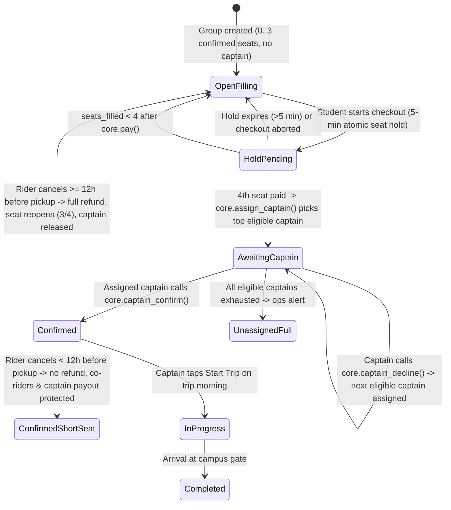

# JUNI Matching Algorithm, Single-Gender Safety & 2-Decimal Fare Engine

**Document Scope:** Single-source technical specification consolidating group matching, strict single-gender rules, 10-fils (`0.01 JD`) largest-remainder fare allocation, 5-minute checkout holds, deterministic captain assignment/decline cascade, and 12-hour cancellation rules.  
**Audit Flaws Resolved:** `F01`, `F03`, `F05`, `F09`, `F12`, `F19`, `F20`.

---

## 1. End-to-End Mechanism

Every JUNI booking follows one deterministic server-enforced pipeline inside PostgreSQL (`core.*`):



---

## 2. Hard Matching & Safety Invariants

### 2.1 Arrival Lead-Time Rule (`class_time - 10 minutes`)
- Students pick their **lecture start time** (e.g., `08:00`) on a valid Jordan teaching day (**Sunday–Thursday**; Friday and Saturday are rejected at validation).
- Target campus gate arrival is fixed at **`lecture_time - 10 minutes`** (`07:50` for an `08:00` class).
- Each pickup gate on the group's corridor has an estimated pickup timestamp derived from corridor travel time (`e.g., Aidoun 07:18 → University St 07:24 → Hawara 07:32 → Al-Sareeh 07:37 → JUST Gate 07:50`).
- **60-Minute Booking Cutoff:** `core.start_checkout` rejects any attempt where `first_pickup_at - now() < interval '60 minutes'`.

### 2.2 Strict Single-Gender Safety Enforcement (`F05` Resolution)
- **Allowed Values:** `gender_pref` on `core.ride_groups` and `gender_pool` on `core.students` allow **ONLY** `'girls_only'` and `'boys_only'`.
- **`'any'` Is Eliminated:** Mixed groups are prohibited at the schema level (`CHECK (gender_pref IN ('girls_only', 'boys_only'))`).
- **Server Predicate (`core.pref_ok`):**
  ```sql
  CREATE OR REPLACE FUNCTION core.pref_ok(p_student_gender text, p_group_pref text)
  RETURNS boolean LANGUAGE sql IMMUTABLE AS $$
    SELECT (p_student_gender = 'female' AND p_group_pref = 'girls_only')
        OR (p_student_gender = 'male'   AND p_group_pref = 'boys_only');
  $$;
  ```
- Both `core.search_groups` and `core.start_checkout` invoke `core.pref_ok`. Even a crafted API request from a male account targeting a `girls_only` group fails with `ERR_GENDER_MISMATCH`.

### 2.3 Atomic 5-Minute Seat Hold (`core.start_checkout`)
- Capacity per car is strictly `4`.
- Active occupancy = `COUNT(confirmed bookings) + COUNT(unexpired holds WHERE expires_at > now())`.
- Locking `core.ride_groups FOR UPDATE` prevents race conditions: if 3 seats are confirmed and Student A holds Seat 4 at `18:00:00`, Student B attempting checkout at `18:00:02` receives `ERR_GROUP_FULL_OR_HELD` until `18:05:00` or until Student A completes/cancels checkout.

---

## 3. Unequal Distance-Weighted Fares & 10-Fils Settlement (`F03`, `F19` Resolution)

### 3.1 Why the Audited Build Showed `1.627 JD`
Jordanian Dinars (`JOD`) divide into `1,000 fils`, while everyday student prices and mobile apps quote two decimals (`X.XX JD`, i.e., multiples of `10 fils`). In the audited build, raw division left non-10-fils remainders (`1,627 fils`), causing `formatFils` to print `1.627 JD`—which judges read as a floating-point bug.

### 3.2 Locked Fare Formula (2-Decimal Exact-Sum Invariant)
For a 4-seat corridor car with total gross fare $C_{\text{fils}}$ (always a multiple of `100 fils`, e.g., `6,000 fils` = `6.00 JD`):

1. **Raw Weight ($w_i$) per Seat $i \in \{1..4\}$:**
   Each rider's weight combines a **25% equal seat-reservation base** (for occupying 1 of 4 physical seats) and a **75% gate-to-campus road distance share** ($d_i$ in km):
   $$w_i = 0.25 \cdot \frac{1}{N} + 0.75 \cdot \frac{d_i}{\sum_{j=1}^{N} d_j}$$
   *(Note: Pure distance share $\alpha = 0, \beta = 1$ or existing corridor weight tables also plug directly into Step 2 below.)*

2. **10-Fils (`0.01 JD`) Largest-Remainder Rounding (`core.round_fares_to_10fils`):**
   Let $U = C_{\text{fils}} / 10$ be the total car fare in **10-fils (`0.01 JD`) integer units** (e.g., $6,000 / 10 = 600$ cents).
   - Compute exact units $u_i = U \cdot w_i$.
   - Take floor units $f_i = \lfloor u_i \rfloor$ and fractional remainder $r_i = u_i - f_i$.
   - Let shortfall $R = U - \sum_{i=1}^{N} f_i$ (guaranteed $0 \le R < N$).
   - Distribute $+1$ unit (`10 fils` = `0.01 JD`) to the $R$ seats with the largest fractional remainders $r_i$ (tie-breaking deterministically by longer distance $d_i$, then `booking_id`).
   - Final seat fare in fils: $\text{fare\_fils}_i = 10 \times f'_i$.

3. **Guaranteed Mathematical Invariants:**
   - **Clean 2-Decimal Display:** $\forall i,\; \text{fare\_fils}_i \bmod 10 = 0$. `formatFils(1630)` **always** renders **`1.63 JD`**, never 3 decimals.
   - **Zero-Leakage Sum:** $\sum_{i=1}^{4} \text{fare\_fils}_i \equiv C_{\text{fils}}$ (`6,000 fils` = `6.00 JD`).
   - **Monotonic Fairness:** If $d_a < d_b$, then $\text{fare\_fils}_a \le \text{fare\_fils}_b$. Closer pickups **never** pay more than farther pickups.
   - **Solo Savings Proof:** Every seat record returns `solo_estimate_fils` (`base 850 fils + 195 fils/km`, rounded to `50 fils`) so the UI displays exact savings (`"1.42 JD vs. 3.70 JD solo · Save 62%"`).

### 3.3 Concrete Worked Example (Sunday `07:50` JUST Girls-Only Car, `C = 6,000 fils`)

| Stop # | Rider | Pickup Gate (`AR · EN`) | Distance ($d_i$) | Raw Units ($u_i$) | Rounded (`10-fils`) | Display Price | Solo Est. | WhatsApp Flat |
| :---: | --- | --- | ---: | ---: | ---: | ---: | ---: | ---: |
| 1 | Dana | `إيدون · Aidoun` | `22.0 km` | `185.15` | `1,850 fils` | **`1.85 JD`** | `5.15 JD` | `5.00 JD` |
| 2 | Noor | `شارع الجامعة · University St` | `19.5 km` | `168.36` | `1,680 fils` | **`1.68 JD`** | `4.65 JD` | `5.00 JD` |
| 3 | **Rama** | `حوارة · Hawara Main Gate` | `14.5 km` | `134.78` | `1,350 fils` | **`1.35 JD`** | `3.70 JD` | `5.00 JD` |
| 4 | Lina | `الصريح · Al-Sareeh` | `11.0 km` | `111.72` | `1,120 fils` | **`1.12 JD`** | `3.00 JD` | `5.00 JD` |
| **Total** | **4 / 4** | **→ JUST Main Gate (`07:50`)** | **`67.0 km`** | **`600.00`** | **`6,000 fils`** | **`6.00 JD`** | — | — |

- **Captain Payout (80%):** `4,800 fils` = **`4.80 JD`**
- **Jeeny / JUNI Commission (20%):** `1,200 fils` = **`1.20 JD`**

*(Note: During `OpenFilling` with 1–3 riders, the UI displays each rider's **4-seat target price** (`1.35 JD`) alongside their **guaranteed ceiling** so students know exact expected cost before paying.)*

---

## 4. Captain Selection, Eligibility Audit & Decline Cascade (`F01`, `F12`)

### 4.1 Eligibility Predicates (`core.assign_captain`)
When the 4th seat transitions to `paid`, `core.assign_captain(p_group_id)` evaluates all captains in deterministic priority order (`priority_rank ASC, captain_id ASC`) and **logs every skipped candidate into `core.captain_dispatch_audit`** so the UI can prove why ineligible captains were rejected (`F12`):

A captain `c` is eligible for group `g` iff ALL hold:
1. **Active Status:** `c.is_active = true`
2. **Valid License on Trip Date:** `c.license_expires_on > g.trip_date` *(Rejects `cap-6` Mazen whose license expired `2026-04-01`, logging `SKIPPED_EXPIRED_LICENSE`)*
3. **Vehicle Capacity:** `c.seat_capacity >= 4`
4. **Not Previously Declined:** `NOT EXISTS` in `core.group_captain_declines(group_id, captain_id)`
5. **No Overlapping Assignment:** No `awaiting_captain`, `confirmed`, or `in_progress` group within `[g.first_pickup_at - 45 min, g.arrival_at + 45 min]` *(Logs `SKIPPED_TIME_CONFLICT`)*

### 4.2 Accept & Decline Transitions
- **`core.captain_confirm(p_group_id, p_captain_id)`:** Verifies `assigned_captain_id = p_captain_id` and `status = 'awaiting_captain'`. Sets `status = 'confirmed'`, `confirmed_at = now()`. Only now do students see **`Confirmed · Captain Accepted`**.
- **`core.captain_decline(p_group_id, p_captain_id, p_reason)`:** Records decline in `core.group_captain_declines`, logs `DECLINED_BY_CAPTAIN` in `captain_dispatch_audit`, clears `assigned_captain_id`, and immediately invokes `core.assign_captain(p_group_id)` in the same transaction to offer the car to the next eligible captain!

---

## 5. 12-Hour Cancellation & Seat-Reopen Rules (`F20`)

Let $\Delta t = \text{first\_pickup\_at} - \text{now}()$:

| Timing Condition | Booking Transition | Refund / Financial Outcome | Group & Captain Outcome |
| --- | --- | --- | --- |
| **Early Cancel ($\Delta t \ge 12\text{ hours}$)** | `status = 'cancelled_early'` | **100% Full Refund** (`refund_fils = paid_fils`, or `0.00 JD` cash obligation cleared) | Seat reopens (`3/4`). If group was `awaiting_captain` or `confirmed`, group reverts to `filling` and assigned captain is cleanly released so they aren't stuck on an underfilled car. |
| **Late Cancel ($\Delta t < 12\text{ hours}$)** | `status = 'cancelled_late'` | **0% Refund** (`refund_fils = 0`; on cash pilot, records `late_cancel_fee_fils = fare_fils` on student ledger) | Co-riders' fares do **not** increase; captain's `80%` payout remains intact; physical seat is marked vacated without breaking confirmation. |
