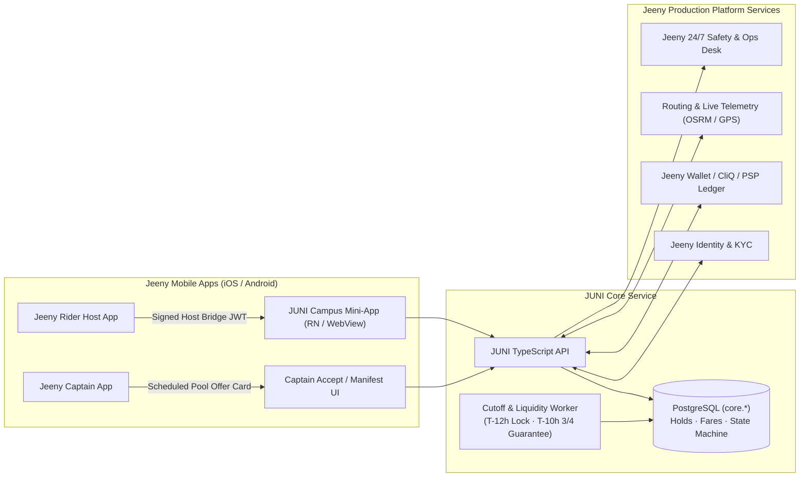

# JUNI Pilot-to-Production Engineering Architecture Roadmap

**Document Scope:** Concrete technical blueprint for graduating JUNI from the **9,250 / 10,000 Hackathon Final Build** into a **10,000 / 10,000 Production Mini-App** inside Jeeny's Jordan production infrastructure.

---

## 1. Architecture Overview (Host Mini-App Integration)

---

## 2. Production Upgrade Workstreams (Closing the Last 750 Points)

### Workstream 1: Identity, `.edu.jo` Verification & Gender Pool Integrity
- **Remove Rehearsal Endpoints:** Compile production container with `JUNI_REHEARSAL_MODE=false` (strips `/api/demo/*` routes completely).
- **Jeeny Host SSO:** Validate short-lived RS256 JWT passed by the Jeeny Host Bridge (`sub: jeeny_user_id`, `phone_e164`, `kyc_status`).
- **Institutional Verification Pipeline:**
  - Automated `.edu.jo` domain OTP (`@cit.just.edu.jo`, `@ses.yu.edu.jo`, `@inu.edu.jo`) via SES/SendGrid with 10-minute TTL and 3-attempt rate limiting.
  - Fallback OCR / Ops review queue for first-semester freshmen holding stamped university registration receipts before campus email activation.
- **Gender Pool Enforcement:** Student gender pool (`girls_only` | `boys_only`) is set once at verified onboarding and immutable without customer-support document review.

### Workstream 2: Jeeny Wallet, CliQ & Two-Phase Settlement Ledger
Graduates from **Cash-First Pilot** (`core.bookings.payment_method = 'cash'`) to **Automated Pre-Authorized Settlement**:
1. **Checkout (`T > 12h`):** Places a zero-fee reservation or `auth_hold` against Jeeny Wallet / CliQ / Card for the exact `10-fils` seat ceiling.
2. **`T - 12h` Cutoff Worker:** Captures `fare_fils` into escrow (`core.ledger_entries` double-entry table: `student_wallet -> juni_escrow`).
3. **Gate Arrival Completion:** Releases `80%` (`4,800 fils`) to Captain's Jeeny Earnings Wallet and `20%` (`1,200 fils`) to Jeeny Platform Revenue.
4. **Cash Coexistence:** Retains Cash option only for students with `trust_score >= 2` completed rides and `unpaid_late_cancel_fils == 0`.

### Workstream 3: Night-Before Liquidity Guarantee Worker (`3/4` Seat Solver)
Scheduled pg-boss / BullMQ worker running at `21:30` (for morning runs) and `T - 3 hours` (for midday runs):
- **Case `4/4` Seats:** Already in captain dispatch (`awaiting_captain` / `confirmed`).
- **Case `3/4` Seats:** Promotes group to `awaiting_captain`, attaches a `pilot_subsidy_fils` journal entry covering the 4th seat delta so students still pay their exact 4-rider distance quote (`1.35 JD`) and the captain still receives `4.80 JD`.
- **Case `1–2` Seats:** Sends push notification via Jeeny FCM/APNs offering 1-tap shift into an adjacent `±15 min` filling car on the same corridor, or auto-releases holds with 10 hours' notice.

### Workstream 4: Live Road Routing, ETA & Telemetry
- **Corridor Polyline & Stop Ordering:** OSRM Jordan graph computes exact stop sequence (`Aidoun → University St → Hawara → Al-Sareeh → JUST Gate`) minimizing total travel duration and storing encoded polylines on `core.ride_groups`.
- **Live Morning Tracking:** Subscribes to Jeeny Captain GPS WebSocket stream starting `30 minutes` before Stop #1 (`first_pickup_at - 30m`), triggering automatic `"Captain 3 minutes from Hawara Gate"` push alerts so curb dwell stays `< 90 seconds`.

### Workstream 5: Live Safety Escalation & Captain Compliance Sync
- **Real-Time Captain Sync:** Webhook from Jeeny Captain DMS revokes captain eligibility immediately if PSV license, insurance, or vehicle inspection expires (`core.captains.license_expires_on`).
- **SOS & Deviation Escalation:** Tapping Emergency inside an `in_progress` JUNI trip transmits `(booking_id, jeeny_user_id, captain_id, live_lat_lng, corridor_deviation_m)` directly to Jeeny's 24/7 Jordan Safety Operations queue with live phone bridge.

### Workstream 6: Full Arabic Localization & RTL Layout
- Extract all UI strings into `i18n/ar-JO.json` and `i18n/en.json` (inheriting active locale from the Jeeny Host App).
- Enable React Native `I18nManager.forceRTL(true)` / CSS logical properties (`margin-inline-start`, `padding-inline-end`, directional chevrons) while preserving LTR formatting on booking codes (`JUNI-XXXXXX`), license plates, and currency numerals (`1.35 د.أ`).

### Workstream 7: Production Observability & Corridor KPIs
Track five core pilot metrics in Grafana / Metabase to gate expansion from Irbid to Amman (`UJ`, `PSUT`, `GJU`) and Zarqa (`Hashemite University`):
1. **4-Seat Organic Fill Rate** *(Target: `>= 78%` by Week 4)*
2. **Captain First-Offer Acceptance Rate** *(Target: `>= 85%` within 10 minutes)*
3. **Gate Arrival Punctuality (`arrival <= class_time - 5m`)** *(Target: `>= 94%`)*
4. **Late Cancellation / Gate No-Show Rate (`< 12h`)** *(Target: `< 3.5%`)*
5. **Weekly Student Repeat Commute Rate** *(Target: `>= 3.2 morning trips / active student / week`)*
